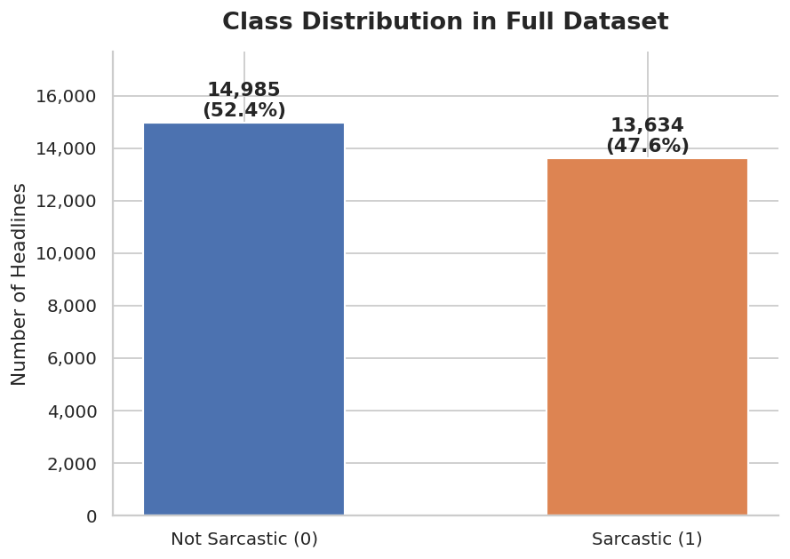
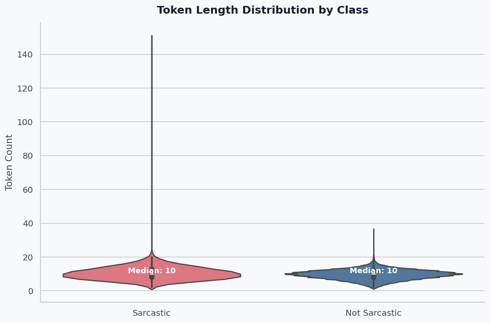
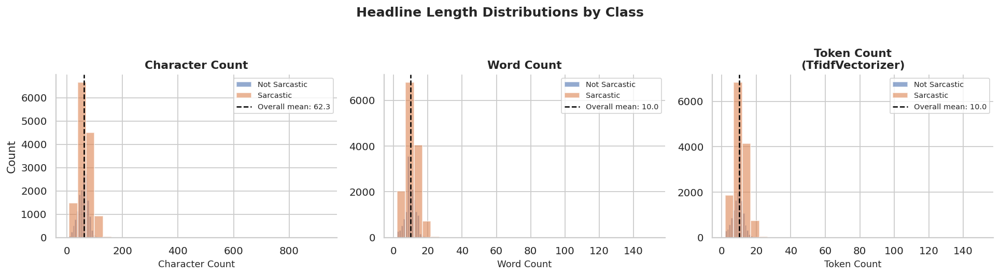
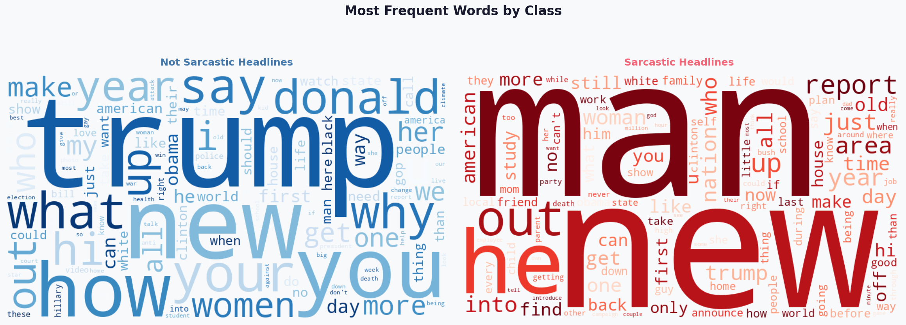
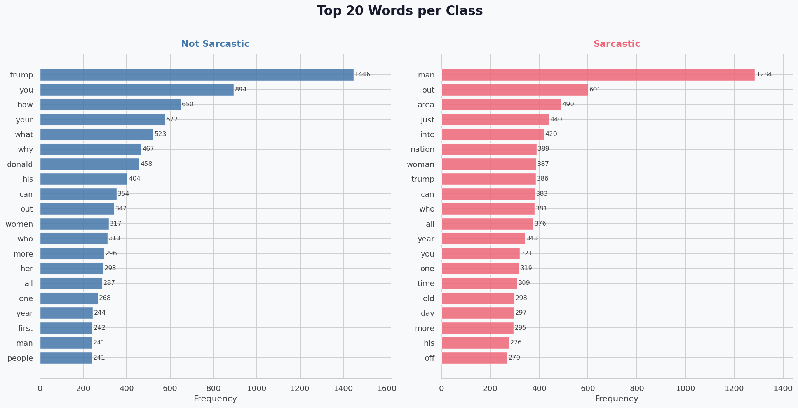
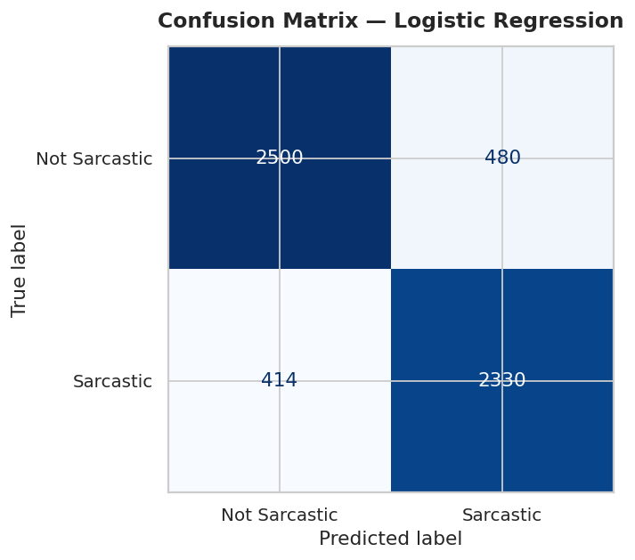
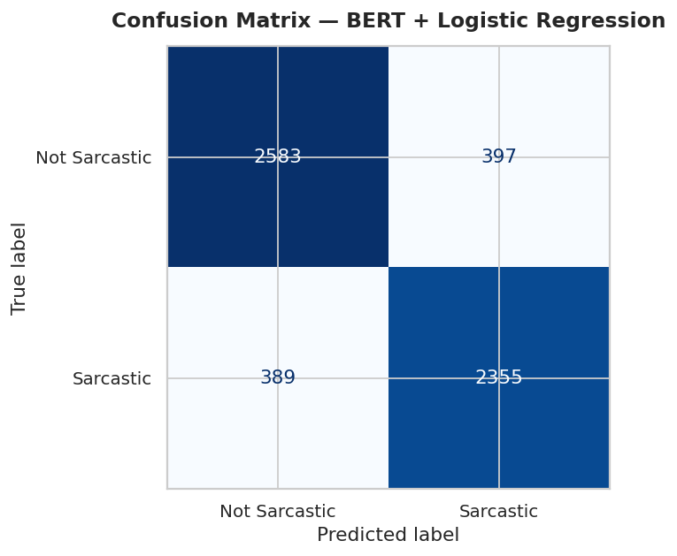
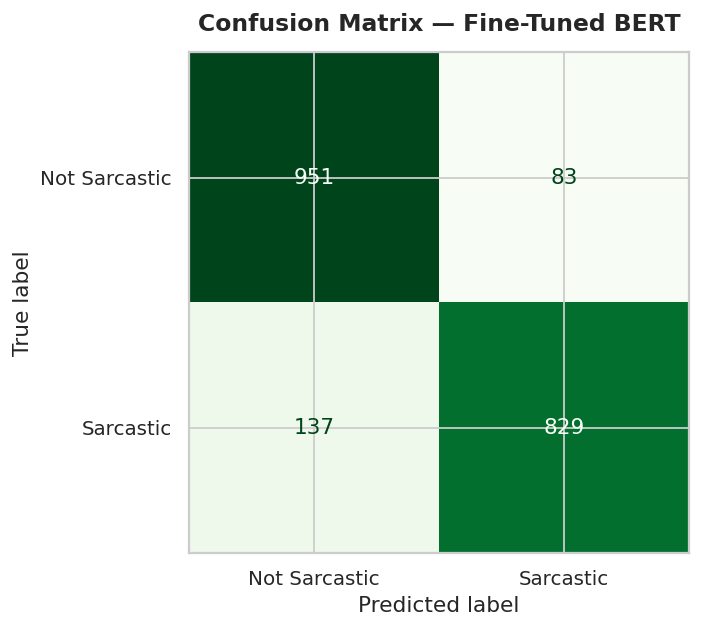
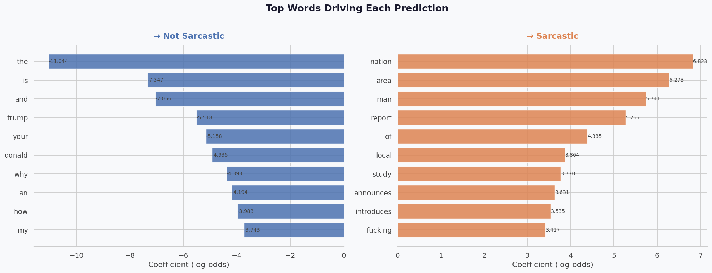

# Sarcasm Detector

Detecting sarcasm in news headlines with classical NLP and transformer models.

Project for the **Micro-degree in Artificial Intelligence and Society** (16 ECTS) at the **University of Graz**, October 2025 – July 2026.

[](https://colab.research.google.com/github/ahmedspaahic/SarcasmDetector/blob/main/notebooks/sarcasm_detector.ipynb)

---

## Contents

- [Overview](#overview)
- [Dataset](#dataset)
- [Exploratory data analysis](#exploratory-data-analysis)
- [Models](#models)
- [Results](#results)
- [Repository structure](#repository-structure)
- [Getting started](#getting-started)
- [References](#references)

## Overview

Sarcasm flips the literal meaning of a sentence, which makes it hard for sentiment analysis and content moderation systems. This project compares three approaches of increasing complexity for classifying a headline as **sarcastic** or **not sarcastic**:

1. **TF-IDF + Logistic Regression**: a bag-of-words baseline
2. **BERT embeddings + Logistic Regression**: frozen `bert-base-uncased` [CLS] embeddings as features
3. **Fine-tuned BERT**: `bert-base-uncased` trained end-to-end for classification

## Dataset

[News Headlines Dataset for Sarcasm Detection](https://www.kaggle.com/datasets/rmisra/news-headlines-dataset-for-sarcasm-detection) (Misra & Arora), version 2:

- **28,619 headlines**: sarcastic ones from *The Onion*, non-sarcastic ones from *HuffPost*
- No missing values; the `article_link` column is dropped
- **80/20 train-test split** (`random_state=66`): 22,895 training and 5,724 test headlines
- Punctuation such as `!` and `?` is intentionally kept, since it can be a signal for sarcasm

Headlines are written by professionals and are self-contained, so the dataset has less noise than Twitter-based sarcasm datasets.

## Exploratory data analysis

| Class distribution | Token length by class |
|:---:|:---:|
|  |  |

- The dataset is **well-balanced**: 14,985 not sarcastic (52.4 %) vs. 13,634 sarcastic (47.6 %), an imbalance ratio of 1.10 : 1. No resampling or class weighting is needed.
- Headlines are short: on average **10 words** (median 10) and **14.8 BERT tokens**. `max_length=32` covers 99.9 % of headlines.
- Sarcastic headlines are slightly longer (10.4 vs. 9.6 tokens on average).







## Models

| Model | Features | Classifier | Notes |
|---|---|---|---|
| TF-IDF + LR | TF-IDF vectors (23,890 features) | Logistic Regression | `max_iter=1000` |
| BERT + LR | 768-dim [CLS] embeddings from frozen `bert-base-uncased` | Logistic Regression | `max_length=64`, `max_iter=2000` |
| Fine-tuned BERT | — | `BertForSequenceClassification` | 1 epoch, lr `2e-5`, batch 32, `max_length=32`, weight decay 0.01, fp16 |

To keep training time short on a Colab T4 GPU, fine-tuning used the first **8,000 training** and **2,000 test** headlines.

## Results

| Model | Accuracy | Precision | Recall | F1 |
|---|---:|---:|---:|---:|
| TF-IDF + Logistic Regression | 84.38 % | 0.8292 | 0.8491 | 0.8390 |
| BERT Embeddings + Logistic Regression | 86.27 % | 0.8557 | 0.8582 | 0.8570 |
| **Fine-Tuned BERT**\* | **89.00 %** | **0.9090** | **0.8582** | **0.8829** |

\* Evaluated on a 2,000-headline subset of the test set (trained on 8,000 headlines).

| TF-IDF + LR | BERT + LR | Fine-Tuned BERT |
|:---:|:---:|:---:|
|  |  |  |

**What the baseline learns.** The logistic regression coefficients show which words push a prediction to each class. Words typical of *The Onion*'s style ("nation", "area", "man", "local", "study", "report") point to sarcasm, while function words and political names ("trump", "donald") point to real news. This also shows a limitation: the baseline partly learns the **writing style of the source** rather than sarcasm itself.



**Takeaways**

- Contextual BERT embeddings beat TF-IDF even without any training of BERT itself (+1.9 pp accuracy).
- Fine-tuning gives the best result, mostly through higher precision (0.91), even with only 8,000 training headlines and a single epoch.
- Possible improvements: fine-tuning on the full training set for more epochs, evaluating on the full test set, and testing on sarcasm from other sources to check that models generalize beyond the two news outlets.

## Repository structure

```
.
├── notebooks/
│   └── sarcasm_detector.ipynb  # full analysis: EDA, all three models, outputs
├── src/sarcasm_detector/
│   ├── data.py                 # Kaggle download, loading, train-test split
│   ├── models.py               # TF-IDF + LR, BERT + LR, fine-tuned BERT
│   └── evaluation.py           # metrics and confusion matrices
├── scripts/
│   ├── run_experiments.py      # train and evaluate the models from the command line
│   └── predict.py              # classify your own headlines
├── docs/images/                # figures from the notebook
└── requirements.txt
```

## Getting started

### Option 1: Google Colab

Click the **Open in Colab** badge above, select a GPU runtime (*Runtime → Change runtime type → T4 GPU*) and run all cells. The dataset is downloaded automatically with `kagglehub`.

### Option 2: Local

```bash
pip install -r requirements.txt
```

Run all three models (a GPU is strongly recommended for the BERT models):

```bash
python scripts/run_experiments.py
```

Run only the baseline (runs on CPU in a few seconds):

```bash
python scripts/run_experiments.py --models tfidf
```

Classify your own headlines:

```bash
python scripts/predict.py "area man passionate defender of what he imagines constitution to be"
```

```
Sarcastic      (p_sarcastic = 0.97)  area man passionate defender of what he imagines constitution to be
```

Metrics (`metrics.csv`) and confusion matrices are saved to `results/`. Run `python scripts/run_experiments.py --help` for all options, e.g. `--data` to use a local copy of the dataset or `--ft-train-size` to fine-tune on more data.

## References

1. R. Misra, P. Arora, *Sarcasm Detection using News Headlines Dataset*, AI Open, 2023.
2. R. Misra, J. Grover, *Sculpting Data for ML: The first act of Machine Learning*, 2021.
3. J. Devlin, M.-W. Chang, K. Lee, K. Toutanova, *BERT: Pre-training of Deep Bidirectional Transformers for Language Understanding*, NAACL 2019.
4. [Hugging Face Transformers](https://huggingface.co/docs/transformers)

---

**Author:** Ahmed Spahić
